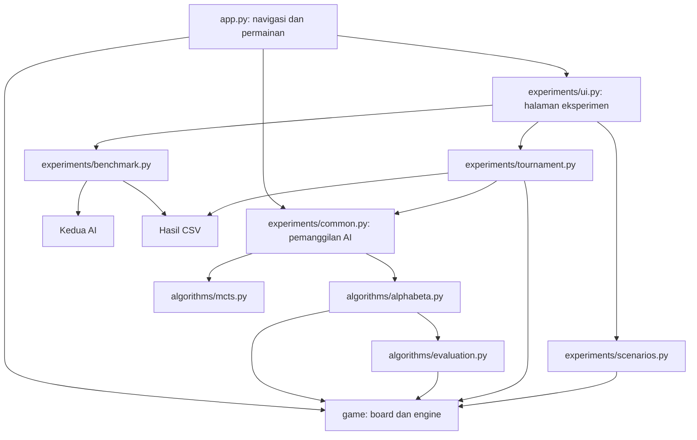

# LAPORAN FINAL PROJECT KONSEP KECERDASAN ARTIFISIAL

## Implementasi dan Analisis Alpha-Beta Pruning serta Monte Carlo Tree Search pada Permainan Othello

**Tanggal penyusunan:** 1 November 2026  
**Bahasa pemrograman:** Python  
**Antarmuka:** Streamlit

> Laporan ini disusun berdasarkan kode pada working tree proyek, pengujian ulang, serta eksekusi ulang benchmark dan tournament pada 1 November 2026. Dataset `results/benchmark.csv` mencakup Alpha-Beta depth 4 dan MCTS 500 iterasi pada midgame, masing-masing 30 pengulangan. Dataset `results/tournament.csv` mencakup dua pertandingan dengan konfigurasi yang sama dan warna ditukar. Lingkungan serta identitas kode dicatat pada `results/experiment_metadata.json`. Bagian yang belum memiliki data dijelaskan sebagai keterbatasan. Hasil tes integrasi tidak digabungkan dengan dataset penelitian.

## BAB I — Pendahuluan

### 1.1 Latar Belakang

Adversarial Search merupakan pendekatan pencarian keputusan dalam lingkungan kompetitif. Suatu tindakan tidak hanya dinilai dari manfaat langsungnya, tetapi juga dari kemungkinan tanggapan lawan. Pada permainan dua pemain, keputusan dapat dimodelkan sebagai penelusuran pohon permainan yang memuat posisi papan, langkah legal, dan pergantian giliran.

Othello dipilih karena mempunyai aturan lokal yang sederhana, tetapi konsekuensi keputusan dapat menjangkau banyak giliran. Satu langkah dapat membalik sejumlah bidak sekaligus, mengubah mobilitas lawan, dan membuka atau menutup akses ke sudut. Oleh karena itu, banyaknya bidak pada suatu giliran belum cukup untuk menilai kualitas posisi secara keseluruhan.

Proyek ini membandingkan dua pendekatan. Alpha-Beta Pruning melakukan pencarian Minimax hingga kedalaman tertentu dengan fungsi evaluasi posisi. MCTS mengembangkan pohon secara bertahap berdasarkan hasil simulasi permainan. Implementasi pertama deterministik untuk posisi dan konfigurasi yang sama, sedangkan implementasi kedua menggunakan pengacakan yang dapat direproduksi melalui seed.

Perbandingan keduanya penting untuk memahami hubungan antara biaya pencarian dan kualitas keputusan. Depth dan iterations merupakan pengendali pekerjaan yang berbeda, sehingga kesamaan nilai parameternya tidak berarti kesamaan biaya komputasi. Evaluasi harus mempertimbangkan waktu, memori, statistik internal, dan hasil pertandingan secara bersamaan.

### 1.2 Rumusan Masalah

1. Bagaimana mengimplementasikan Alpha-Beta Pruning dan MCTS pada permainan Othello dengan kontrak data dan aturan yang konsisten?
2. Bagaimana perbandingan kompleksitas waktu dan ruang kedua algoritma secara teoretis serta berdasarkan data empiris yang tersedia?
3. Bagaimana depth dan iterations mengendalikan proses pencarian, dan sejauh mana pengaruhnya terhadap performa dapat dibuktikan melalui eksperimen?
4. Bagaimana kemampuan bermain kedua algoritma ketika warna dipertukarkan, serta bagaimana karakteristik posisi opening, midgame, dan endgame digunakan dalam pengujian?

### 1.3 Tujuan

Tujuan proyek adalah membangun permainan Othello yang dapat dimainkan melalui GUI, menyediakan dua algoritma AI dengan antarmuka pemanggilan yang konsisten, dan memisahkan aturan permainan dari antarmuka pengguna. Proyek juga bertujuan menyediakan pengukuran waktu dan memori yang dapat diulang, pertandingan otomatis dengan pertukaran warna, serta skenario yang dapat diverifikasi melalui riwayat langkah legal.

Analisis dilakukan untuk menjelaskan mekanisme pencarian dan menghubungkannya dengan hasil yang tersedia. Kesimpulan dibatasi oleh cakupan dataset agar hasil dua pertandingan atau satu konfigurasi benchmark tidak digeneralisasi menjadi keunggulan universal suatu algoritma.

### 1.4 Batasan Masalah

1. Permainan menggunakan papan standar 8×8, dua pemain, informasi sempurna, dan hitam bergerak terlebih dahulu.
2. Algoritma yang diteliti adalah Minimax dengan Alpha-Beta Pruning dan MCTS dengan UCT.
3. Alpha-Beta menggunakan heuristik tetap `25C + 5M + D`; nilai terminal dipisahkan dari evaluasi nonterminal.
4. MCTS menggunakan konstanta eksplorasi `sqrt(2)`, rollout acak uniform, dan reward menang/seri/kalah sebesar `1.0/0.5/0.0`.
5. Program menggunakan Python dan Streamlit. Benchmark dan tournament dapat berjalan tanpa GUI.
6. Metrik memori adalah peak alokasi Python yang dilacak `tracemalloc`, bukan total resident memory proses.
7. Dataset benchmark mencakup Alpha-Beta depth 4 dan MCTS 500 iterasi pada midgame, masing-masing 30 pengulangan. Dataset pertandingan berisi satu pasangan warna pada konfigurasi tersebut.
8. Belum dilakukan eksperimen batas waktu berpikir yang sama, penyapuan parameter, maupun pengujian kemampuan bermain dari beragam posisi awal.
9. Tidak digunakan transposition table, pembelajaran bobot heuristik, atau rollout berbasis pengetahuan posisi.

## BAB II — Landasan Teori

### 2.1 Adversarial Search

Dalam model proyek, state terdiri dari papan dan pemain yang mendapat giliran. Action merupakan koordinat penempatan bidak yang legal. Transition menghasilkan papan berikutnya setelah penempatan dan pembalikan bidak. Terminal state terjadi ketika permainan tidak dapat dilanjutkan oleh kedua pemain. Utility menyatakan hasil akhir dari perspektif pemain tertentu.

Game tree dibentuk dengan menjadikan state awal sebagai root dan state setelah action sebagai child. Node MAX memilih nilai terbesar dari perspektif pemain root, sedangkan node MIN memilih nilai terkecil. Penetapan MAX atau MIN harus mengikuti pemain yang benar-benar mendapat giliran. Pada Othello, pass dapat menyebabkan pemain yang sama bermain kembali, sehingga label MAX dan MIN tidak selalu berganti hanya berdasarkan kedalaman node.

Pada proyek ini, hasil akhir didefinisikan sebagai menang, kalah, atau seri berdasarkan jumlah bidak. Sebelum terminal, kualitas posisi diperkirakan melalui heuristik atau statistik simulasi sesuai algoritma yang digunakan.

### 2.2 Permainan Othello

Pada awal permainan terdapat empat bidak pada pusat papan. Langkah dilakukan pada kotak kosong yang menjepit sedikitnya satu bidak lawan dalam garis horizontal, vertikal, atau diagonal. Semua bidak lawan yang terjepit akibat langkah tersebut dibalik. Pemain yang tidak mempunyai langkah wajib pass; permainan berakhir ketika kedua pemain tidak dapat bergerak, dan jumlah bidak menentukan pemenang. Aturan ini mengikuti aturan Othello yang dipublikasikan World Othello Federation. [Aturan resmi Othello](https://www.worldothello.org/about/about-othello/othello-rules/official-rules/english).

Representasi dalam proyek menggunakan `EMPTY = 0`, `BLACK = 1`, dan `WHITE = -1`. Koordinat `(row, col)` menggunakan indeks 0–7, dengan baris nol di atas dan kolom nol di kiri. Penggunaan bilangan bertanda membuat lawan pemain dapat ditentukan melalui `-player`.

### 2.3 Minimax dan Alpha-Beta Pruning

Minimax memilih tindakan dengan mengasumsikan bahwa lawan juga memilih tanggapan terbaik. Alpha-Beta mempertahankan hasil Minimax pada pohon dan evaluasi yang sama sambil menghindari pemeriksaan cabang yang tidak lagi dapat memengaruhi keputusan. Alpha adalah batas bawah nilai yang dapat dipertahankan MAX, sedangkan beta adalah batas atas yang dapat dipertahankan MIN. Cutoff dilakukan ketika `alpha >= beta`. Urutan pemeriksaan langkah memengaruhi besarnya penghematan pencarian. [Knuth dan Moore, An Analysis of Alpha-Beta Pruning](https://www.sciencedirect.com/science/article/pii/0004370275900193).

Dalam implementasi proyek, pencarian dihentikan ketika depth tersisa nol atau posisi terminal. Leaf nonterminal menggunakan heuristik; leaf terminal menggunakan hasil kemenangan. Langkah diperiksa dalam urutan koordinat sehingga hasil deterministik dan pemilihan pada nilai seri mengikuti koordinat terkecil.

### 2.4 Monte Carlo Tree Search

MCTS menggabungkan pengembangan pohon dengan perkiraan nilai melalui simulasi. Empat tahap dasarnya adalah selection untuk memilih jalur, expansion untuk menambahkan child, simulation untuk memperoleh hasil permainan, dan backpropagation untuk memperbarui statistik jalur. [Browne dkk., A Survey of Monte Carlo Tree Search Methods](https://repository.essex.ac.uk/4117/1/MCTS-Survey.pdf).

Selection menggunakan Upper Confidence Bound applied to Trees atau UCT:

$$
UCT_i = \overline{X_i} + c\sqrt{\frac{\ln N}{n_i}}.
$$

Pada rumus tersebut, $\overline{X_i}$ adalah rata-rata reward child, $N$ adalah jumlah kunjungan parent, dan $n_i$ adalah jumlah kunjungan child. Komponen pertama mengutamakan hasil yang sudah baik, sedangkan komponen kedua mendorong eksplorasi. UCT menerapkan gagasan bandit pada pencarian pohon. [Kocsis dan Szepesvári, Bandit Based Monte-Carlo Planning](https://people.eecs.berkeley.edu/~russell/classes/cs294/s11/readings/Kocsis%2BSzepesvari:2006.pdf).

Dalam proyek, child menyimpan reward dari perspektif pemain yang memilih tindakan pada parent. Karena itu, selection pada giliran lawan tetap memaksimalkan kepentingan lawan, bukan reward root secara membuta. Nilai `c` ditetapkan `sqrt(2)` dan keputusan akhir memakai visit count terbesar, dengan koordinat terkecil sebagai pemecah seri.

### 2.5 Kompleksitas Algoritma

Time complexity menyatakan pertumbuhan jumlah pekerjaan ketika ukuran parameter bertambah. Space complexity menyatakan pertumbuhan kebutuhan penyimpanan secara serentak. Analisis ini berbeda dari pengukuran milidetik dan byte pada perangkat tertentu.

Notasi yang digunakan adalah:

| Simbol | Makna |
| --- | --- |
| $b$ | Batas atau pendekatan branching factor, yaitu jumlah langkah legal per node |
| $d$ | Kedalaman pencarian berdasarkan penempatan bidak |
| $I$ | Jumlah iterasi MCTS |
| $h$ | Kedalaman maksimum pohon eksplisit MCTS |
| $L$ | Panjang rollout, termasuk perpindahan saat pass |
| $S$ | Ukuran penyimpanan satu papan |
| $C_r$ | Biaya pemrosesan aturan, termasuk pencarian langkah legal |

Untuk papan tetap 8×8, ukuran papan dapat diperlakukan sebagai konstanta ketika menganalisis pertumbuhan terhadap $d$ atau $I$. Meskipun demikian, operasi memeriksa langkah legal tetap mempunyai biaya nyata dan dapat berbeda antarimplementasi.

## BAB III — Perancangan dan Implementasi

### 3.1 Arsitektur Sistem

Sistem dipisahkan menjadi antarmuka, aturan permainan, algoritma, dan eksperimen. Pembagian ini memungkinkan pengujian algoritma tanpa menjalankan Streamlit.



`game/board.py` menyediakan kelas `Board` serta fungsi `create_board()` dan `copy_board()`. `game/engine.py` menyediakan kelas `GameEngine` dan API fungsional untuk AI, UI, dan eksperimen. Antarmuka kelas dipertahankan untuk kompatibilitas, sedangkan integrasi utama menggunakan list-of-lists dan fungsi tanpa mutasi input.

MCTS menggunakan papan datar 64 elemen dan fungsi aturan internal untuk mempercepat rollout. Dengan demikian, algoritma ini belum memanggil engine bersama pada setiap transisi internalnya. Tournament tetap memvalidasi langkah dan menjalankan perubahan papan pertandingan menggunakan engine bersama. Perbedaan implementasi aturan internal ini perlu diperhatikan saat menafsirkan perbandingan kecepatan dan menjaga konsistensi.

### 3.2 Implementasi Game Engine

Papan awal dibuat sebagai delapan baris independen dengan masing-masing delapan elemen. Bidak putih berada pada `(3,3)` dan `(4,4)`, sedangkan hitam berada pada `(3,4)` dan `(4,3)`. `copy_board()` menyalin setiap baris sehingga perubahan salinan tidak mengubah papan asal.

Validasi langkah dilakukan dengan memeriksa delapan arah. Pada setiap arah, engine mengumpulkan rangkaian bidak lawan hingga menemukan bidak pemain sendiri atau batas yang memutus rangkaian. Rangkaian hanya diterima jika ditutup bidak sendiri. Hasil flip dan langkah legal dikembalikan terurut.

API utama adalah:

| Fungsi | Perilaku |
| --- | --- |
| `get_flips(board, row, col, player)` | Menemukan bidak yang dibalik, atau `[]` untuk langkah tidak legal |
| `get_valid_moves(board, player)` | Menghasilkan seluruh koordinat legal terurut |
| `apply_move(board, row, col, player)` | Mengembalikan papan baru; langkah ilegal menghasilkan `ValueError` |
| `has_valid_move(board, player)` | Memeriksa keberadaan langkah |
| `is_terminal(board)` | Memeriksa apakah kedua pemain tidak mempunyai langkah |
| `get_next_player(board, current_player)` | Memilih lawan, pemain yang sama jika lawan pass, atau `None` saat terminal |
| `get_score(board)` | Mengembalikan tuple `(black_count, white_count)` |
| `get_winner(board)` | Mengembalikan `1`, `-1`, atau `0`; nonterminal ditolak |

Pemain selain hitam dan putih ditolak. API fungsional tidak mengubah papan input. Metode kelas `Board.apply_move()` memang mengubah instance miliknya, tetapi fungsi publik `game.engine.apply_move()` menjalankannya pada salinan. Pemisahan tersebut mempertahankan kode kelas yang sudah ada sambil memenuhi kebutuhan pencarian yang harus mempertahankan state parent.

### 3.3 Implementasi Alpha-Beta Pruning

Fungsi utama adalah `get_best_move(board, player, depth=4)`. Depth minimal satu. Setiap penempatan bidak mengurangi sisa depth satu, sedangkan pass tidak mengurangi anggaran penempatan. Pemain berikutnya ditentukan melalui engine sehingga giliran yang sama setelah lawan pass tetap ditangani dengan perspektif yang benar.

Pseudocode konseptualnya adalah:

```text
BEST_MOVE(board, player, depth):
    tolak depth < 1
    moves = langkah legal terurut
    jika moves kosong: kembalikan None dan statistik
    best = -takhingga; alpha = -takhingga; beta = +takhingga
    untuk setiap move dalam moves:
        child = apply_move(board, move, player)
        value = evaluasi terminal atau SEARCH(child, depth - 1, alpha, beta)
        jika value > best: simpan value dan move
        alpha = max(alpha, best)
    kembalikan move terbaik dan statistik

SEARCH(board, player, depth, alpha, beta):
    catat kunjungan dan kedalaman
    jika terminal atau depth == 0: kembalikan evaluasi
    jika tidak ada langkah: lanjutkan dengan pemain lawan dan depth tetap
    untuk setiap langkah legal:
        bangun child dan cari nilainya
        perbarui maksimum atau minimum sesuai player == root_player
        perbarui alpha atau beta
        jika alpha >= beta: catat child legal tersisa dan hentikan loop
```

Heuristik nonterminal yang diterapkan adalah:

$$
H(s,p)=25C+5M+D,
$$

dengan $C$ selisih sudut, $M$ selisih jumlah langkah legal, dan $D$ selisih jumlah bidak dari perspektif pemain $p$. Sebagai contoh, selisih satu sudut menyumbang 25 poin sebelum komponen lain dijumlahkan. Bobot ini merupakan baseline tetap, bukan hasil optimasi dari dataset.

Untuk posisi terminal:

$$
H(s,p)=
\begin{cases}
100000+D, & \text{menang},\\
-100000+D, & \text{kalah},\\
0, & \text{seri}.
\end{cases}
$$

Pengecekan terminal didahulukan di fungsi evaluasi. Statistik yang dikumpulkan adalah `nodes_visited`, `nodes_expanded`, `max_depth_reached`, dan `pruned_branches`. Metrik terakhir menghitung child legal yang dilewati akibat cutoff, bukan perkiraan jumlah seluruh descendant yang tidak dibangun.

Terdapat batasan instrumentasi pada kode saat laporan disusun: child terminal dapat langsung dievaluasi tanpa masuk fungsi rekursif, sehingga `max_depth_reached` belum selalu mencatat kedalaman child tersebut. Jumlah kunjungan juga mengikuti pemanggilan rekursif, bukan seluruh papan yang dievaluasi di luar fungsi tersebut. Keterbatasan ini harus dipertimbangkan sebelum menggunakan statistik Alpha-Beta sebagai ukuran seluruh pekerjaan.

### 3.4 Implementasi MCTS

Fungsi utama adalah `get_best_move(board, player, iterations=500, seed=None)`. Input disalin menjadi papan datar. Implementasi membangun daftar arah atau rays untuk tiap kotak agar pemeriksaan garis tidak harus menghitung ulang koordinat arah setiap saat.

Setiap node menyimpan board, player to move, parent, children, visits, total reward, move, mover, dan daftar tindakan yang belum dicoba. Jika pemain tidak mempunyai langkah tetapi lawan masih dapat bergerak, daftar tindakan memuat penanda pass internal. Penanda tersebut tidak menjadi langkah publik: fungsi utama tetap mengembalikan `None` apabila pemain root harus pass.

Alur satu iterasi adalah sebagai berikut:

1. Mulai dari root dan pilih child dengan nilai UCT terbesar selama node tidak memiliki tindakan yang belum dicoba.
2. Jika tersedia, pilih satu tindakan yang belum dicoba secara acak dan tambahkan maksimal satu child.
3. Salin papan node tersebut, lalu lakukan rollout hingga kedua pemain berturut-turut tidak dapat bergerak.
4. Pilih langkah rollout secara uniform dari daftar langkah legal menggunakan `random.Random(seed)` lokal.
5. Tambahkan visits dan reward pada node serta seluruh parent hingga root.

Reward disimpan dari perspektif `mover`, yaitu pemain yang bertindak pada parent. Dengan konstruksi ini, seluruh child dari parent dinilai dari perspektif pemain yang sama. Pass juga menjadi transisi eksplisit dan tidak menempatkan bidak.

Setelah seluruh iterasi selesai, child root dengan kunjungan terbesar dipilih; jika seri, koordinat terkecil digunakan. Langkah legal root yang belum dibuat memiliki visit count nol. Statistik meliputi `nodes_visited`, `nodes_expanded`, `max_depth_reached`, `simulations`, dan `tree_size`. Kedalaman mengacu pada pohon eksplisit, bukan panjang rollout. Pada root tanpa langkah, fungsi mengembalikan `None` tanpa menjalankan rangkaian rollout.

### 3.5 Implementasi Antarmuka

Streamlit menyediakan navigasi **Permainan** dan **Eksperimen**. Halaman permainan menampilkan papan 8×8, skor, giliran, penanda langkah legal manusia, pesan pass, pemenang, dan statistik AI terakhir. Tiga mode yang tersedia adalah Human vs Human, Human vs AI, serta AI vs AI.

Pengguna dapat memilih warna manusia, algoritma AI tiap pemain, depth Alpha-Beta, iterations MCTS, dan seed. **New Game** menerapkan konfigurasi baru, sedangkan **Reset** mengulang permainan dengan konfigurasi aktif. Giliran AI dijalankan melalui tombol khusus untuk mencegah pencarian ulang hanya karena Streamlit melakukan rerun.

State permainan dan hasil eksperimen disimpan di `st.session_state`. Berpindah halaman tidak menghapus papan atau hasil terakhir. Pada halaman eksperimen, form menampung konfigurasi dan proses hanya berjalan ketika tombol submit ditekan.

Tab Benchmark menyediakan pemilihan satu atau kedua algoritma, skenario, parameter, pengulangan, dan seed. Hasilnya berupa ringkasan rata-rata, median, simpangan baku, tabel tiap pengulangan, grafik waktu dan memori, serta unduhan CSV. Tab Tournament menyediakan konfigurasi pertandingan, jumlah pasangan, ringkasan menang/seri, durasi, tabel pertandingan, dan unduhan CSV. Statistik node ditampilkan terpisah dari grafik waktu dan memori.

### 3.6 Implementasi Sistem Eksperimen

`experiments/benchmark.py` memanggil algoritma pada salinan posisi yang sama secara serial. Import algoritma dan salinan awal papan disiapkan sebelum pengukuran. Setiap pengulangan memulai sesi `tracemalloc` baru, mencatat `perf_counter_ns()` sebelum dan sesudah pemanggilan AI, mengambil peak memory, lalu menghentikan tracing melalui blok `finally`.

Waktu dikonversi ke milidetik. Pengukuran tidak mencakup rendering GUI, penyimpanan CSV, maupun pembuatan skenario. Namun, pengukuran waktu mencakup overhead tracing selama AI dijalankan. Memori mengacu pada alokasi yang dilacak setelah tracing dimulai. Pengertian metrik ini sesuai dokumentasi [tracemalloc](https://docs.python.org/3.13/library/tracemalloc.html) dan penghitung waktu [perf_counter_ns](https://docs.python.org/3.13/library/time.html#time.perf_counter_ns).

Untuk pengulangan MCTS ke-$r$, seed adalah `seed + r`. CSV memuat algoritma, parameter, indeks pengulangan, seed, waktu, peak memory, dan statistik algoritma. Pemanggilan CLI juga menambahkan nama skenario.

`experiments/tournament.py` memainkan dua game per pasangan, menukar warna Alpha-Beta dan MCTS, serta memvalidasi setiap langkah sebelum menerapkannya pada engine bersama. Seed dasar pasangan ke-$k$ adalah `seed + k * 1000`; keputusan MCTS ke-$j$ memakai seed dasar ditambah $j$. CSV mencatat konfigurasi, warna, pemenang, skor, jumlah penempatan, dan durasi. Durasi pertandingan ini tidak diukur dengan tracing memori aktif, sehingga tidak setara dengan penjumlahan waktu benchmark yang diinstrumentasi.

`experiments/scenarios.py` membentuk posisi dengan selalu memilih langkah legal terkecil secara leksikografis. Opening mengambil posisi awal, midgame setelah 24 penempatan, dan endgame setelah 50 penempatan. Riwayat menyimpan `(player, move)` sehingga posisi dan pemain aktif dapat direplay. Pemain yang tercatat sama pada dua penempatan berturut-turut menunjukkan lawan pass.

Eksekusi melalui terminal tetap tersedia:

```powershell
python -m experiments.benchmark alphabeta --parameter 4 --scenario midgame --repetitions 30 --seed 42 --output results/benchmark-alphabeta.csv
python -m experiments.benchmark mcts --parameter 500 --scenario midgame --repetitions 30 --seed 42 --output results/benchmark-mcts.csv
python -m experiments.tournament --pairs 1 --depth 4 --iterations 500 --seed 42 --output results/tournament.csv
```

Perintah benchmark di atas menghasilkan file terpisah per algoritma. Dataset laporan menggabungkan kedua hasil menjadi `results/benchmark.csv` melalui `save_csv()`; field khusus algoritma yang tidak berlaku dibiarkan kosong. Perintah tersebut mereproduksi konfigurasi, bukan menjamin angka waktu dan memori identik. CLI menimpa nama file output yang sama. Halaman eksperimen memakai keluaran sementara untuk tournament dan menyediakan CSV sebagai unduhan, sehingga tidak otomatis menimpa dataset penelitian di `results/`.

## BAB IV — Pengujian dan Analisis

### 4.1 Lingkungan dan Metodologi Pengujian

Seluruh benchmark dan tournament pada dataset terbaru dijalankan ulang pada perangkat serta lingkungan berikut. Metadata direkam langsung oleh proses yang menjalankan eksperimen:

| Komponen | Hasil pemeriksaan |
| --- | --- |
| Prosesor | Intel Core i7-14700HX |
| Logical processors yang terlihat Python | 28 |
| Memori fisik yang dilaporkan OS | 34.049.327.104 byte, sekitar 31,71 GiB |
| Sistem operasi | Windows 11, build 26200, 64-bit |
| Python | CPython 3.13.5, 64-bit |
| Streamlit | 1.66.1 |
| pandas | 3.1.0 |
| pytest | 9.2.0 |
| Pengukuran waktu benchmark | `time.perf_counter_ns()`, hasil dalam ms |
| Pengukuran memori benchmark | Peak allocated Python memory melalui `tracemalloc` |

Eksekusi berlangsung pada **1 November 2026, 23:50:15–23:51:55 WIB (UTC+07:00)**. File `results/experiment_metadata.json` mencatat hardware, versi perangkat lunak, waktu setiap tahap, konfigurasi, papan dan riwayat skenario, hash SHA-256 kode sumber, serta hash kedua CSV. Commit dasar adalah `b5d7143`; karena working tree memuat perubahan yang belum di-commit, hash sumber digunakan untuk mengidentifikasi kode yang benar-benar dijalankan. Dengan demikian, tabel lingkungan di atas merujuk langsung ke eksekusi dataset baru.

Konfigurasi data empiris yang tersedia adalah:

| Dataset | Algoritma dan konfigurasi | Posisi | Banyak data | Seed |
| --- | --- | --- | --- | --- |
| `results/benchmark.csv` | Alpha-Beta, depth 4 | Midgame, putih mendapat giliran | 30 pencarian | Tidak menggunakan pengacakan |
| `results/benchmark.csv` | MCTS, 500 iterasi | Midgame yang sama | 30 pencarian | 42–71 |
| `results/tournament.csv` | Alpha-Beta depth 4 vs MCTS 500 iterasi | Papan awal standar | 2 pertandingan, satu pasangan warna | Seed dasar 42; ditambah indeks keputusan MCTS |

Semua 60 baris benchmark dianalisis per algoritma, masing-masing 30 sampel, tanpa menghapus pengukuran lambat. Proses berjalan serial dalam satu interpreter: seluruh pengulangan Alpha-Beta, kemudian MCTS, lalu tournament setelah tracing benchmark berhenti. Tidak ada warm-up khusus, pemanggilan garbage collector eksplisit, atau penonaktifan garbage collector. Mode daya, suhu CPU, dan aktivitas aplikasi lain tidak dikendalikan; urutan algoritma juga tidak diacak. Karena itu, perbandingan waktu merupakan hasil teramati dari protokol ini, bukan efek algoritma murni yang telah mengendalikan seluruh faktor runtime.

Rata-rata dan median digunakan bersama untuk menggambarkan sebaran. Simpangan baku yang dilaporkan adalah simpangan baku sampel dengan penyebut $n-1$. Satuan KiB didefinisikan sebagai 1.024 byte.

Untuk sampel $x_1,\ldots,x_n$:

$$
\overline{x}=\frac{1}{n}\sum_{i=1}^{n}x_i,
\qquad
s=\sqrt{\frac{\sum_{i=1}^{n}(x_i-\overline{x})^2}{n-1}}.
$$

Pengulangan benchmark MCTS sekaligus memvariasikan seed, sehingga variasinya mencampurkan efek jalur acak dan kondisi eksekusi. Pengulangan tersebut bukan 30 posisi independen. Demikian pula, dua game dengan seed dasar berpasangan bukan sampel besar untuk mengestimasi kekuatan umum algoritma.

### 4.2 Pengujian Fungsional

Pengujian ulang dijalankan dari root proyek dengan perintah:

```powershell
.\.venv\Scripts\python.exe -B -m pytest -q -p no:cacheprovider
```

Hasil pemeriksaan adalah **106 passed, 1 skipped** dari 107 kasus tes yang dikumpulkan. Rincian berdasarkan modul adalah:

| Modul tes | Lulus | Dilewati | Cakupan utama |
| --- | ---: | ---: | --- |
| `tests/test_engine.py` | 25 | 0 | Papan awal, copy, legal move, flip multi-arah, input ilegal, pass, terminal, pemenang |
| `tests/test_alphabeta.py` | 22 | 0 | Heuristik, terminal, depth 1/2/4/6, legalitas, determinisme, statistik, kesetaraan nilai dengan Minimax referensi |
| `tests/test_mcts.py` | 41 | 0 | Iterasi, seed, legalitas, input tetap, UCT, reward, rollout terminal, pass internal, ukuran tree, konversi input |
| `tests/test_integration.py` | 14 | 1 | Benchmark, CSV, seed, pertukaran warna, replay skenario, pertandingan penuh, tiga mode UI |
| `tests/test_experiments_ui.py` | 4 | 0 | Pengiriman konfigurasi, hasil persisten, unduhan tersedia, error, eksperimen kecil dengan AI asli, navigasi |
| **Total** | **106** | **1** | |

Tes yang dilewati memeriksa layar peringatan saat engine belum tersedia. Engine sudah terpasang sehingga kondisi tes tersebut tidak berlaku. Pengujian juga menghasilkan peringatan deprecation pandas dari komponen grafik Streamlit; peringatan tersebut bukan kegagalan pengujian.

Posisi awal mempunyai empat langkah hitam tepat `(2,3)`, `(3,2)`, `(4,5)`, dan `(5,4)`. Setelah hitam bermain `(2,3)`, skor menjadi 4–1 dan papan input fungsi tetap tidak berubah. Tes juga memeriksa terminal ketika masih ada kotak kosong tetapi kedua pemain tidak mempunyai langkah.

Kelulusan tes mendukung perilaku yang dicakup kasus tersebut. Hasil ini tidak membuktikan ketiadaan seluruh bug atau menghapus keterbatasan pencatatan kedalaman Alpha-Beta yang dijelaskan pada Bagian 3.3.

### 4.3 Analisis Kompleksitas Teoretis

Untuk model pohon seragam dengan biaya node konstan, Minimax dan Alpha-Beta memiliki batas terburuk $O(b^d)$. Pada pengurutan langkah ideal, Alpha-Beta dapat mencapai orde $O(b^{d/2})$; keuntungan itu tidak otomatis dicapai oleh pengurutan koordinat proyek. Pruning mengurangi node yang diperiksa, bukan mengganti tujuan Minimax. [Knuth dan Moore](https://www.sciencedirect.com/science/article/pii/0004370275900193).

Analisis berikut diturunkan dari struktur implementasi proyek, dengan biaya aturan dinyatakan eksplisit:

| Aspek | Alpha-Beta | MCTS proyek |
| --- | --- | --- |
| Pengendali pekerjaan | Depth $d$ | Iterations $I$ |
| Waktu | Terburuk $O(b^d C_r)$; penghematan bergantung cutoff | $O(I[h b + L C_r + C_{expand}])$ sebagai batas kerja per iterasi |
| Struktur yang disimpan | Jalur rekursi, papan aktif, daftar legal move pada frame | Node eksplisit yang bertambah, daftar child/untried, papan tiap node |
| Ruang | $O(d(S+b))$ pada jalur aktif | $O(I(S+b)+L_{work})$ sebagai batas atas jika setiap iterasi menambah node |

Pada MCTS, selection memindai child untuk menghitung UCT, sehingga faktor $b$ tidak selalu boleh dihilangkan. $C_{expand}$ mencakup copy board, apply move, serta pembentukan daftar langkah node baru. $L_{work}$ adalah memori kerja rollout; implementasinya iteratif sehingga tidak menyimpan seluruh urutan papan rollout.

Untuk ukuran papan tetap, branching factor dan panjang permainan mempunyai batas. Dengan batas tersebut, waktu MCTS dapat diperkirakan proporsional terhadap iterasi pada wilayah kerja tertentu. Namun, ungkapan sederhana $O(I L)$ mengabaikan selection, pemeriksaan legalitas, dan perkembangan kedalaman tree. Karena itu, linearitas waktu praktis perlu diuji, bukan diasumsikan dari jumlah simulasi saja.

Alpha-Beta tidak menyimpan seluruh pohon sekaligus. Di sisi lain, MCTS mempertahankan node yang sudah dibuat untuk digunakan kembali dalam iterasi berikutnya pada pencarian yang sama. Hal ini menjelaskan perbedaan pola penyimpanan tanpa membutuhkan klaim bahwa salah satunya selalu lebih hemat untuk semua konfigurasi. Pada papan 8×8, banyaknya penempatan tersisa juga membatasi kedalaman efektif.

### 4.4 Analisis Waktu Eksekusi

Hasil dihitung per algoritma dari `results/benchmark.csv` yang telah diperbarui. Keduanya memakai papan midgame dan pemain aktif yang sama.

| Statistik | Alpha-Beta depth 4 | MCTS 500 iterasi |
| --- | ---: | ---: |
| Jumlah pengulangan | 30 | 30 |
| Rata-rata (ms) | 49,397 | 2.577,285 |
| Median (ms) | 48,251 | 2.588,316 |
| Simpangan baku sampel (ms) | 7,530 | 2.053,283 |
| Minimum (ms) | 41,974 | 505,478 |
| Maksimum (ms) | 80,163 | 5.436,114 |
| Koefisien variasi (%) | 15,244 | 79,668 |

Pada pengukuran ini, rata-rata waktu MCTS sekitar **52,175 kali** rata-rata Alpha-Beta. Angka tersebut adalah rasio hasil pada depth 4 dan 500 iterasi di satu posisi, bukan perbandingan dengan anggaran komputasi setara atau bukti bahwa rasio yang sama berlaku pada semua posisi.

Alpha-Beta mengunjungi 106 node rekursif dan mencatat 163 child legal yang terpangkas pada setiap pengulangan. MCTS menyelesaikan 500 simulasi hingga terminal, sehingga pekerjaannya mencakup langkah rollout yang tidak muncul dalam hitungan node tree eksplisit. Mekanisme ini membantu menjelaskan perbedaan beban kerja, tetapi perbedaan representasi papan dan kondisi runtime juga berpengaruh.

Waktu MCTS bervariasi dari 505,478 sampai 5.436,114 ms. Nilai minimum tidak dipilih sebagai satu-satunya hasil: seluruh sampel tetap dipakai. Seed mengubah jalur tree dan rollout, sedangkan mode daya, suhu, aktivitas latar belakang, dan biaya garbage collection tidak dicatat per pengulangan. Data belum memisahkan kontribusi faktor-faktor tersebut. Karena algoritma dijalankan berurutan, perubahan kondisi sistem sepanjang rangkaian juga dapat memengaruhi rasio waktu.

Dataset baru sudah mendukung perbandingan kedua algoritma pada satu konfigurasi masing-masing. Namun, dataset ini **belum mendukung kurva waktu terhadap depth atau iterations**, karena depth hanya 4 dan iterations hanya 500. Pengujian fungsional depth 1, 2, 4, dan 6 tidak menggantikan pengukuran pertumbuhan waktu. Eksperimen lanjutan perlu menyapu depth 1/2/4/6 dan iterations 100/500/1.000 pada posisi identik, tetap menggunakan metode tracing yang sama.

### 4.5 Analisis Penggunaan Memori

Peak allocated Python memory dihitung per pemanggilan. Berikut ringkasan dalam KiB (1 KiB = 1.024 byte):

| Statistik peak memory | Alpha-Beta depth 4 (KiB) | MCTS 500 iterasi (KiB) |
| --- | ---: | ---: |
| Rata-rata | 4,003 | 436,467 |
| Median | 3,938 | 436,742 |
| Simpangan baku sampel | 0,357 | 1,531 |
| Minimum | 3,938 | 430,617 |
| Maksimum | 5,891 | 437,906 |

Rata-rata memori terlacak Alpha-Beta adalah 4.098,7 byte, sedangkan MCTS 446.942,1 byte. Pada konfigurasi ini, peak memory rata-rata MCTS sekitar **109,046 kali** Alpha-Beta. Ini merupakan perbandingan alokasi yang dilacak selama fungsi berjalan, bukan rasio total penggunaan RAM aplikasi.

Hasil tersebut sejalan dengan struktur penyimpanan kode: Alpha-Beta mempertahankan jalur rekursi aktif dan dapat melepas papan cabang setelah selesai, sedangkan MCTS mempertahankan tree dengan 501 node untuk dipakai kembali sepanjang iterasinya. Node MCTS juga menyimpan parent, child, reward, dan tindakan yang belum dicoba. Alpha-Beta tidak menyimpan seluruh 106 state yang dieksplorasi secara bersamaan.

Papan awal dan import disiapkan sebelum tracing. Library yang sudah berada di memori serta alokasi yang tidak dilacak tidak seluruhnya masuk pengukuran. Peak memory MCTS tidak dapat diartikan sebagai seluruh resident memory proses. Perbedaan kecil antar-pengulangan tidak diuraikan menjadi kontribusi per objek karena snapshot alokasi tidak direkam.

Perbandingan empiris kini tersedia untuk depth 4 versus 500 iterasi pada midgame. Kurva memori terhadap kenaikan depth/iterations dan generalisasi ke fase lain tetap memerlukan konfigurasi tambahan.

### 4.6 Analisis Efektivitas Pencarian

Statistik MCTS dari 30 pengulangan dirangkum sebagai berikut:

| Metrik | Rata-rata | Rentang |
| --- | ---: | ---: |
| `nodes_visited` | 2.281,033 | 2.267–2.299 |
| `nodes_expanded` | 500 | 500–500 |
| `max_depth_reached` | 5,167 | 5–6 |
| `simulations` | 500 | 500–500 |
| `tree_size` | 501 | 501–501 |

Kesamaan `simulations` dan iterations menunjukkan seluruh 500 rollout selesai pada posisi benchmark. Hubungan `tree_size = nodes_expanded + 1` juga terpenuhi karena root dihitung sebagai satu node. Pada dataset ini, setiap iterasi memang menambahkan satu node; sifat tersebut tidak harus berlaku pada seluruh posisi, misalnya jika pohon permainan yang sangat kecil sudah habis dikembangkan.

Rasio agregat kunjungan per simulasi sekitar $2281,033/500 = 4,562$. Angka ini menyatakan rata-rata jumlah node eksplisit yang dilewati pada selection/expansion, termasuk root; angka tersebut bukan panjang permainan simulasi. Kedalaman maksimum 5–6 menunjukkan rollout dapat jauh lebih panjang daripada jalur pohon yang disimpan.

Statistik Alpha-Beta depth 4 pada 30 pengulangan adalah:

| Metrik | Nilai setiap pengulangan |
| --- | ---: |
| `nodes_visited` | 106 |
| `nodes_expanded` | 106 |
| `max_depth_reached` | 4 |
| `pruned_branches` | 163 |

Kesamaan statistik sesuai dengan sifat deterministik Alpha-Beta pada papan dan urutan langkah yang sama. Nilai 163 berarti child legal yang belum dikunjungi akibat cutoff; angka tersebut bukan jumlah seluruh descendant yang berhasil dihindari. Karena benchmark Minimax tanpa pruning tidak direkam, persentase penghematan terhadap ukuran pohon Minimax penuh belum dapat dihitung. Tes unit memeriksa kesetaraan nilai dengan Minimax referensi pada posisi/depth yang sama.

Hitungan 106 kunjungan Alpha-Beta tidak dapat dibandingkan sebagai satuan pekerjaan yang sama dengan sekitar 2.281 kunjungan MCTS. MCTS menjalankan rollout tambahan, dan definisi kunjungan mengikuti proses internal yang berbeda.

Distribusi kunjungan antar-child root belum diekspor oleh API/CSV MCTS. Laporan belum dapat menampilkan apakah kunjungan terkonsentrasi pada satu tindakan, menghitung entropy distribusi, atau menghubungkan konsentrasi tersebut dengan pilihan langkah. Statistik global juga tidak cukup untuk menyatakan kualitas keputusan tanpa hasil pertandingan atau nilai referensi.

### 4.7 Analisis Kemampuan Bermain

Dataset tournament menggunakan Alpha-Beta depth 4 dan MCTS 500 iterasi. Hasil aktual adalah:

| Game | Hitam | Putih | Skor hitam–putih | Pemenang | Penempatan | Durasi |
| --- | --- | --- | --- | --- | ---: | ---: |
| 0 | Alpha-Beta | MCTS | 52–12 | Alpha-Beta | 60 | 10,416 s |
| 1 | MCTS | Alpha-Beta | 12–52 | Alpha-Beta | 60 | 10,828 s |

Untuk $N$ pertandingan, digunakan:

$$
WinRate_A=\frac{W_A}{N}\times100\%,\qquad
DrawRate=\frac{D_{game}}{N}\times100\%.
$$

Margin dari perspektif Alpha-Beta didefinisikan sebagai jumlah bidak Alpha-Beta dikurangi jumlah bidak MCTS. Dengan definisi tersebut:

| Metrik | Alpha-Beta | MCTS |
| --- | ---: | ---: |
| Menang | 2 | 0 |
| Kalah | 0 | 2 |
| Win rate teramati | 100% | 0% |
| Draw rate keseluruhan | 0% | 0% |
| Rata-rata margin bidak | +40 | −40 |

Total durasi kedua game adalah 21,244 detik dan rata-ratanya 10,622 detik. Enam puluh penempatan ditambah empat bidak awal menghasilkan papan penuh pada kedua game. Pass tidak dihitung sebagai penempatan.

Pertukaran warna menunjukkan kemenangan Alpha-Beta tidak hanya muncul ketika algoritma tersebut menjadi hitam pada pasangan yang diuji. Hasil ini konsisten dengan kemungkinan bahwa pencarian depth 4 dan heuristik posisi memberikan keputusan lebih baik daripada 500 rollout uniform pada lintasan tersebut. Namun, penjelasan kausal tersebut masih berupa dugaan mekanistik: CSV tidak memuat analisis kualitas setiap langkah.

Dua game belum cukup untuk mengestimasi peluang menang umum. Tidak ada variasi pasangan seed maupun posisi awal, dan depth 4 tidak disetarakan dengan 500 iterasi berdasarkan waktu berpikir. Oleh sebab itu, angka 100% adalah ringkasan dua game yang tercatat, bukan jaminan bahwa Alpha-Beta selalu mengalahkan MCTS.

### 4.8 Analisis Berdasarkan Fase Permainan

Skenario yang dihasilkan kode diverifikasi melalui replay langkah legal. Karakteristiknya adalah:

| Skenario | Penempatan setelah awal | Bidak terisi | Kotak kosong | Hitam | Putih | Pemain aktif | Langkah legal pemain aktif |
| --- | ---: | ---: | ---: | ---: | ---: | --- | ---: |
| Opening | 0 | 4 | 60 | 2 | 2 | Hitam | 4 |
| Midgame | 24 | 28 | 36 | 8 | 20 | Putih | 5 |
| Endgame | 50 | 54 | 10 | 13 | 41 | Hitam | 3 |

Posisi ini berasal dari kebijakan pembentukan deterministik, bukan sampel acak posisi yang mewakili seluruh fase Othello. Pemilihan koordinat terkecil berulang dapat menghasilkan pola papan yang berbeda dari permainan manusia atau AI yang kuat. Oleh karena itu, satu posisi per fase harus diperlakukan sebagai kasus uji tetap.

Pada opening, jumlah bidak dan mobilitas kedua pihak masih simetris. Pada midgame yang dipakai benchmark, pemain putih mempunyai lima tindakan root dan terdapat 36 kotak kosong. Pada endgame, hanya sepuluh kotak kosong tersisa, sehingga batas panjang permainan lebih pendek. Secara mekanistik, rollout endgame dapat membutuhkan lebih sedikit penempatan, tetapi waktu aktual tetap bergantung legalitas, pass, dan struktur pencarian.

Hanya midgame mempunyai rekaman benchmark performa. Opening dan endgame sudah tersedia dan diuji legalitas/replay-nya, tetapi belum memiliki 30 pengulangan benchmark dalam dataset. Karena itu, laporan belum menyimpulkan fase mana yang tercepat, paling hemat memori, atau paling menguntungkan bagi salah satu AI.

### 4.9 Pembahasan Keseluruhan

Implementasi telah menghubungkan dua metode pencarian dengan aturan pertandingan, GUI, benchmark, dan tournament. Pengujian menunjukkan bahwa input papan dipertahankan oleh API pencarian, langkah yang dipilih legal pada kasus uji, seed MCTS dapat direproduksi, dan seluruh permainan dapat dijalankan sampai terminal.

Perbedaan utama kedua metode tampak pada pengendali dan penyimpanan pencarian. Alpha-Beta mengandalkan cakupan hingga depth tertentu dan kualitas heuristik. MCTS menggunakan anggaran simulasi serta mempertahankan tree untuk mengarahkan iterasi berikutnya. Banyaknya node yang diperiksa tidak mempunyai makna komputasi yang identik karena MCTS juga menjalankan rollout yang tidak dicatat sebagai node eksplisit.

Pada benchmark ulang midgame, Alpha-Beta depth 4 memerlukan rata-rata 49,397 ms dan peak memory rata-rata 4,003 KiB, sedangkan MCTS 500 iterasi memerlukan 2.577,285 ms dan 436,467 KiB. Dengan konfigurasi yang diuji, Alpha-Beta mencatat waktu serta alokasi terlacak lebih rendah dan menang pada kedua game tournament. Variasi waktu MCTS cukup besar dan urutan pengukuran tidak diacak, sehingga hasil ini belum membuktikan keunggulan umum atau rasio performa yang tetap di berbagai kondisi.

Keterbatasan yang memengaruhi interpretasi adalah:

1. **Cakupan benchmark terbatas.** Kedua algoritma sudah diukur, tetapi hanya pada depth 4 versus 500 iterasi di satu posisi midgame. Belum ada variasi parameter atau perbandingan seluruh fase.
2. **Sampel kemampuan bermain kecil.** Hanya satu pasangan warna dan satu seed dasar, tanpa pengujian signifikansi atau estimasi kepercayaan yang kuat.
3. **Anggaran komputasi belum disetarakan.** Depth dan iterations tetap tidak menjamin waktu berpikir yang sama.
4. **Implementasi aturan internal berbeda.** MCTS memakai papan datar dan rays internal; Alpha-Beta memanggil engine berbasis grid. Waktu dapat mencerminkan optimasi representasi selain pilihan algoritma.
5. **Kondisi runtime belum sepenuhnya dikendalikan.** Hardware, versi kode/library, waktu eksekusi, dan hash output sudah dicatat pada metadata pendamping, tetapi mode daya, suhu, aplikasi latar belakang, dan urutan algoritma belum dikendalikan sebagai faktor eksperimen.
6. **Instrumentasi terbatas.** Tidak ada panjang rollout, distribusi visit root, atau jejak evaluasi tiap langkah. Kedalaman child terminal Alpha-Beta belum selalu masuk statistik.
7. **Papan uji terbatas.** Satu lintasan pembentukan leksikografis tidak mewakili distribusi posisi pertandingan umum.

Dengan keterbatasan tersebut, temuan mendukung keberhasilan integrasi dan hasil pada konfigurasi yang tercatat. Kesimpulan mengenai keunggulan waktu, memori, atau kualitas lintas konfigurasi memerlukan eksperimen tambahan.

## BAB V — Penutup

### 5.1 Kesimpulan

1. **Implementasi dan integrasi.** Alpha-Beta Pruning dan MCTS berhasil diintegrasikan dengan permainan Othello, antarmuka Streamlit, serta modul eksperimen. Pengujian ulang menghasilkan 106 kasus lulus dan satu dilewati karena layar dependensi belum tersedia tidak lagi relevan.
2. **Kompleksitas dan biaya empiris.** Alpha-Beta mempunyai biaya terburuk eksponensial terhadap depth pada model branching factor tetap, sementara MCTS mengendalikan pekerjaan melalui iterasi dengan biaya selection, expansion, rollout, dan backpropagation. Pada midgame yang sama, Alpha-Beta depth 4 menghasilkan rata-rata waktu 49,397 ms dan peak memory rata-rata 4,003 KiB, sedangkan MCTS 500 iterasi menghasilkan 2.577,285 ms dan 436,467 KiB. Alpha-Beta mencatat kedua metrik lebih rendah pada konfigurasi ini, dengan catatan bahwa anggaran komputasi belum disetarakan dan kondisi runtime tidak sepenuhnya dikendalikan.
3. **Pengaruh parameter.** Depth membatasi penempatan yang ditelusuri Alpha-Beta, sedangkan iterations membatasi jumlah rollout MCTS. Dataset mengonfirmasi 500 rollout selesai dan 501 node tree pada konfigurasi yang diuji. Pengaruh peningkatan parameter terhadap kurva waktu, memori, dan kekuatan bermain belum terukur karena belum ada penyapuan parameter.
4. **Kemampuan bermain dan fase.** Pada dua game dengan warna ditukar, Alpha-Beta depth 4 menang atas MCTS 500 iterasi dengan margin 40 bidak pada kedua game. Win rate teramati adalah 100% untuk Alpha-Beta dalam pasangan tersebut. Skenario opening, midgame, dan endgame tersedia serta dapat direplay, tetapi perbandingan performa lintas fase belum didukung dataset yang memadai.

### 5.2 Saran Pengembangan

Prioritas pengembangan berikutnya adalah melengkapi bukti eksperimen sebelum menarik kesimpulan yang lebih luas:

1. Jalankan benchmark kedua algoritma pada ketiga fase, dengan variasi depth 1/2/4/6 dan iterations 100/500/1.000, serta simpan tiap konfigurasi ke file berbeda.
2. Tambahkan beberapa posisi legal per fase dari seed atau lintasan pembentukan yang berbeda, bukan hanya satu posisi leksikografis.
3. Perbanyak pasangan pertandingan dan seed; pertahankan pertukaran warna, lalu laporkan ketidakpastian win rate serta distribusi margin.
4. Pertahankan metadata pendamping yang sudah merekam hardware, versi Python/library, hash kode/output, dan waktu pengukuran; tambahkan pencatatan suhu/mode daya serta kendalikan aplikasi latar belakang. Pertimbangkan urutan konfigurasi yang diacak agar perubahan kondisi sistem tidak selalu berimpit dengan satu algoritma.
5. Tambahkan eksperimen anggaran waktu berpikir setara setelah benchmark konfigurasi tetap selesai; pisahkan hasilnya sebagai metode eksperimen berbeda.
6. Perbaiki instrumentasi kedalaman Alpha-Beta, lalu tambahkan panjang rollout, visit distribution root MCTS, serta statistik per langkah bila diperlukan untuk analisis efektivitas.
7. Teliti move ordering, transposition table, iterative deepening, dan depth adaptif pada Alpha-Beta sebagai varian terpisah.
8. Teliti bobot heuristik berdasarkan fase dan rollout policy yang mempertimbangkan sudut atau mobilitas. Perubahan ini harus dicatat sebagai konfigurasi baru agar tidak tercampur dengan baseline.
9. Pertahankan tes kesetaraan aturan antara MCTS internal dan engine, atau gunakan implementasi aturan bersama setelah dampak performanya diukur.

## Daftar Pustaka

1. Knuth, D. E., dan Moore, R. W. (1975). *An Analysis of Alpha-Beta Pruning*. Artificial Intelligence, 6(4), 293–326. [Artikel penerbit](https://www.sciencedirect.com/science/article/pii/0004370275900193).
2. Kocsis, L., dan Szepesvári, C. (2006). *Bandit Based Monte-Carlo Planning*. ECML 2006, 282–293. [Naskah publik](https://people.eecs.berkeley.edu/~russell/classes/cs294/s11/readings/Kocsis%2BSzepesvari:2006.pdf).
3. Browne, C. B., dkk. (2012). *A Survey of Monte Carlo Tree Search Methods*. IEEE Transactions on Computational Intelligence and AI in Games, 4(1), 1–43. [Repositori University of Essex](https://repository.essex.ac.uk/4117/).
4. World Othello Federation. *Official Rules for the Game Othello*. [Aturan resmi](https://www.worldothello.org/about/about-othello/othello-rules/official-rules/english).
5. Python Software Foundation. *tracemalloc — Trace Memory Allocations*, dokumentasi Python 3.13. [Dokumentasi](https://docs.python.org/3.13/library/tracemalloc.html).
6. Python Software Foundation. *time.perf_counter_ns*, dokumentasi Python 3.13. [Dokumentasi](https://docs.python.org/3.13/library/time.html#time.perf_counter_ns).

## Lampiran — Sumber Data dan Reproduksi

Sumber primer lokal laporan adalah kode `game/`, `algorithms/`, `experiments/`, `app.py`, seluruh modul tes, hasil eksekusi ulang `results/benchmark.csv` dan `results/tournament.csv`, serta `results/experiment_metadata.json`. Angka agregat pada Bab IV dihitung ulang per algoritma dari dataset terbaru. Hash kedua CSV pada metadata memungkinkan pengecekan bahwa file analisis masih sama dengan hasil eksekusi ini.

Contoh perhitungan ulang ringkasan benchmark:

```python
import csv
import statistics

with open("results/benchmark.csv", encoding="utf-8", newline="") as handle:
    rows = list(csv.DictReader(handle))

for algorithm in ("alphabeta", "mcts"):
    selected = [row for row in rows if row["algorithm"] == algorithm]
    times = [float(row["execution_time_ms"]) for row in selected]
    memory = [int(row["peak_memory_bytes"]) for row in selected]
    print(algorithm, "n:", len(selected))
    print("mean ms:", statistics.mean(times))
    print("median ms:", statistics.median(times))
    print("sample std ms:", statistics.stdev(times))
    print("mean peak KiB:", statistics.mean(memory) / 1024)
```

Angka pada laporan menggunakan koma sebagai tanda desimal dan titik sebagai pemisah ribuan, sedangkan CSV menggunakan titik sebagai tanda desimal. Benchmark dan tournament telah dijalankan ulang untuk dataset laporan ini. Sebanyak 30 baris Alpha-Beta dan 30 baris MCTS digabungkan dalam satu CSV; field `simulations`/`tree_size` kosong untuk Alpha-Beta dan `pruned_branches` kosong untuk MCTS karena tidak berlaku. Penyapuan parameter dan benchmark fase lain belum dijalankan.
